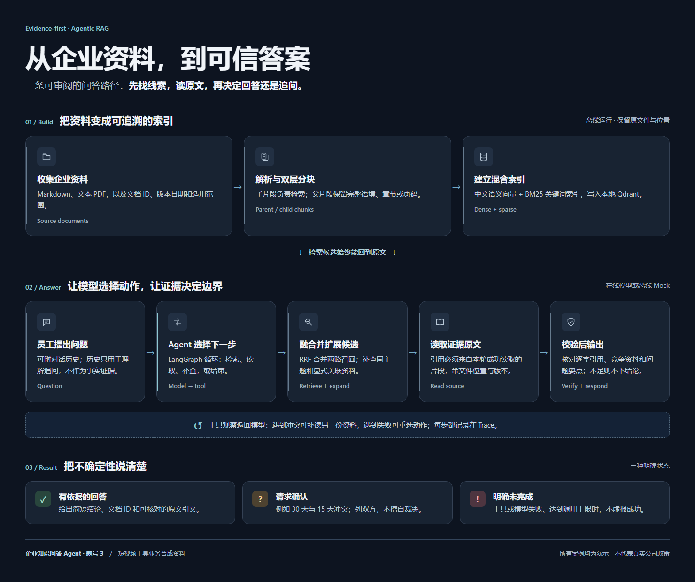

# 企业知识问答 Agent

> 小影科技校招笔试 · 题号 3 · CLI 项目

员工问“删除的云端草稿在回收站保留多久？”时，系统会先检索，再读取相关制度原文。若两份资料分别写着 30 天和 15 天，且没有说明适用范围或优先级，结果就列出双方引文并请求确认，而不是替用户选一个期限。

本仓库是可运行的 CLI 项目，提供 DeepSeek 在线模型与离线 Mock 两条入口。所有制度、产品能力和案例均为**合成资料**，不代表真实小影科技的政策或产品承诺。

**评审入口：** [需求与验收点](docs/01-requirements.md) · [设计与取舍](docs/02-solution.md) · [测试与限制](docs/03-evaluation.md) · [AI 使用记录](docs/04-ai-usage.md) · [复盘](docs/05-retrospective.md)。想先看实际行为，可直接打开下方的[冲突输入](examples/video_tool_kb/inputs/retention_conflict.json)和[真实模型 Trace](examples/video_tool_kb/retention_conflict.json)。

## 工作流程



流程图由[响应式 HTML 原稿](docs/architecture.html)渲染；GitHub 首页显示上方预览，下载 HTML 后可在浏览器中单独打开。

| 能力 | 当前实现 |
|---|---|
| **模型动态决策** | LangGraph 的模型与工具节点循环；模型选择检索、读原文、补查或结束，工具调用上限默认 8 次。 |
| **混合检索** | 中文 dense 向量 `BAAI/bge-small-zh-v1.5` + jieba 分词的 `Qdrant/bm25`，按 RRF 融合；检索子片段，引用父片段。 |
| **冲突处理** | 扩展同主题及显式引用的文档；未给适用优先级时列双方证据并追问。 |
| **引用校验** | 引文须逐字来自本轮成功读取的片段；检查竞争资料、问题要点及“未规定”等资料缺口。失败不输出确定答案。 |
| **可审阅 Trace** | 记录动作、工具参数、返回摘要、后续动作和简要依据，不暴露模型内部思维。 |
| **故障边界** | 工具错误、调用超限、无效模型输出和接口故障返回明确状态；无效 JSON 最多尝试一次格式修复。 |

### 一次问答实际怎样运行

1. **建库：**从 Markdown 或可提取文字的 PDF 读取正文和侧车元数据，保留文档 ID、版本日期、适用范围、章节或页码。长文档先按原文语境切父片段，再为检索切子片段；本地 Qdrant 同时保存中文语义向量和 BM25 稀疏向量。
2. **找线索：**模型决定调用 `search_documents` 并给出查询词。工具分别检索两种向量，以 RRF 合并排序，将命中的子片段映射回父片段；再补入同主题资料及原文显式提及的文档。这个补查能降低只找到冲突一方的风险，但依赖资料标注。
3. **读原文：**模型根据候选选择 `read_snippet(doc_id, snippet_id)`。工具结果回到模型，模型可以继续检索、读取另一份资料、请求确认或结束。LangGraph 保留每轮状态；Trace 记录可审阅的动作与观察。
4. **核对输出：**引用必须是本轮成功读取的连续原文，并附文档 ID、位置、版本和范围。程序还检查同主题竞争资料、问题中的关键实体和引文是否真的覆盖问题。证据不足时返回待确认；执行失败或达到工具上限时返回未完成。

模型负责**选动作**，本地程序负责**守住证据与状态边界**。检索结果只是候选，不能直接当作答案；对话历史只帮助理解“它”“这个规则”等追问，不充当事实来源。

### 冲突怎样处理

本项目的 K13 与 K14 是刻意构造的冲突：前者写回收站保留 **30 天**，后者写 **15 天**。二者都没有给出适用套餐、地区、版本或优先级。检索器会尽量让两份进入候选；模型读取后，输出 `needs_clarification`、双方逐字引文，以及需要确认适用制度的问题。**版本日期较新并不自动覆盖旧文档。** 若资料中只存在一方且引用足以回答，才可给出单一答案。

目前的冲突拦截偏保守：同主题资料文本不同可能触发确认，即使差异未必构成逻辑矛盾。它保护了该题的关键边界，但并非任意企业文档的通用冲突推理器。

## 运行记录与验收点

| 场景 | 观察结果 | 输入与真实模型记录 |
|---|---|---|
| **正常回答** | 自动字幕需要人工校对；答案带 K01 原文引用。 | [输入](examples/video_tool_kb/inputs/subtitle.json) · [Trace](examples/video_tool_kb/subtitle.json) |
| **资料冲突** | K13 写 30 天，K14 写 15 天；不擅自选新版本，要求确认适用制度。 | [输入](examples/video_tool_kb/inputs/retention_conflict.json) · [Trace](examples/video_tool_kb/retention_conflict.json) |
| **资料不足** | MP4 导出说明不能证明支持 4K HDR；请求补充资料。 | [输入](examples/video_tool_kb/inputs/four_k_unknown.json) · [Trace](examples/video_tool_kb/four_k_unknown.json) |

题目要求的六种情况都能在仓库核对：

| 验收点 | 核对位置 | 预期边界 |
|---|---|---|
| 明确答案 | [字幕案例](examples/video_tool_kb/subtitle.json) | 给出答案与可回查的 K01 引文 |
| 文档冲突 | [草稿期限案例](examples/video_tool_kb/retention_conflict.json) | 同时列出 K13、K14，请求确认 |
| 资料外问题 | [4K HDR 案例](examples/video_tool_kb/four_k_unknown.json) | 不把 MP4 导出误说成 4K HDR 支持 |
| 改写相似问题 | [在线改写案例](examples/online/paraphrase.json) | 换一种问法仍能找到 D03 |
| 上下文追问 | [在线追问案例](examples/online/followup.json) | 用历史确定所问主题，引用仍来自文档 |
| 工具失败 | [读取失败案例](examples/video_tool_kb/read_failure.json) | 失败不计为成功；补查后才允许回答 |

另有[达到上限](tests/test_agent.py)、[无效模型输出](examples/video_tool_kb/subtitle_first_attempt.json)、[资料替换后答案改变](examples/online/replaced.json)和[仅保留冲突一方](examples/online/d01_only.json)的验证。在线 Trace 来自较早版本；最新格式修复与问答相关性拦截已通过离线测试，**2026-11-03 DeepSeek 接口返回 HTTP 503，尚未完成新版本的在线重复成功率验证**。

## 运行项目

环境：Python 3.11+、PowerShell。项目不需要单独运行 Qdrant 服务；索引建在本机目录中。首次安装：

```powershell
git clone https://github.com/Moming0215/enterprise-qa-agent.git
cd enterprise-qa-agent
python -m venv .venv
.\.venv\Scripts\python.exe -m pip install -e '.[test]'
if (-not (Test-Path .env)) { Copy-Item .env.example .env }
```

### 1. 建立短视频业务知识库索引

```powershell
.\.venv\Scripts\python.exe -m src.ingest_cli --source data/video_tool_kb/sources --index data/index/video_tool_kb
```

预期报告包含 `indexed_files: 44`、`failures: []`。首次向量化会下载模型；索引保存在本地 `data/index/`，不会进入 Git。

建库是离线步骤，**更换或新增资料后需要重新运行**。若报告的 `failures` 非空，请先看具体文件的解析错误；索引器不会把失败文件算作已收录。当前会递归读取来源目录中的 `.md` 和文本型 `.pdf`；扫描件尚需 OCR，DOCX、表格等格式尚未接入。

### 2. 不用 API，检查流程

```powershell
.\.venv\Scripts\python.exe -m src.cli --input examples/video_tool_kb/inputs/retention_conflict.json --mode mock --index-dir data/index/video_tool_kb --max-steps 30 --output examples/private/mock-conflict.json
.\.venv\Scripts\python.exe -m pytest -q
```

Mock 只证明工具链与边界规则，不能证明真实模型会怎样决策；扩大语料后它会机械读取较多候选，所以示例将工具上限设为 30。当前测试结果为 **50 passed**，见[实际输出](examples/video_tool_kb_v2/test-results.txt)。

要模拟工具故障，可在上述命令加 `--fail-tool read_snippet`（只注入一次）。也可改成 `search_documents`。检查输出里的 `trace`，确认失败步骤没有被记录为成功。

### 3. 使用真实模型

在本机 `.env` 中填写 `DEEPSEEK_API_KEY`；默认接口与模型写在 [.env.example](.env.example)。不要提交 `.env`。运行：

```powershell
.\.venv\Scripts\python.exe -m src.cli --input examples/video_tool_kb/inputs/retention_conflict.json --mode online --index-dir data/index/video_tool_kb --output examples/private/online-conflict.json
```

CLI 在终端打印结果，同时保存 JSON。主要字段：`status`（`answered`、`needs_clarification`、`incomplete`）、`answer`、`citations`、`gaps`、`clarifying_question`、`error`、`trace`。`incomplete` 的退出码为 2。自定义问题参照[输入格式](examples/video_tool_kb/inputs/subtitle.json)，可加入 `history` 数组；CLI 参数见 `python -m src.cli --help`。

### 4. 用自己的问题与资料复现

在项目根目录新建一个 UTF-8 输入文件，例如 `examples/private/my-question.json`：

```json
{"question": "删除的云端草稿在回收站保留多久？"}
```

将在线命令里的 `--input` 换成这个文件即可。追问可传 `history` 数组，每项为含 `role`、`content` 的消息；可参照[追问输入](examples/inputs/followup.json)。

要换资料，创建自己的来源目录，放入 `.md` 或文本型 `.pdf`，并为需要追踪的文件配同名侧车文件，如 `policy.md.meta.json`：

```json
{"doc_id":"P01","topic":"draft_retention","version_date":"2026-10-01","scope":"云端草稿服务"}
```

然后用 `src.ingest_cli --source 你的目录 --index 你的索引目录` 建库，再在问答命令中通过 `--index-dir` 指向该索引。`doc_id` 需要唯一；同主题资料建议使用相同 `topic`，便于冲突候选扩展。不要将真实制度、客户资料或密钥提交到此公开仓库。

### 如何读输出

| 字段 | 含义 |
|---|---|
| `answered` | 引文已通过校验，当前资料支持回答；仍应核对业务适用范围 |
| `needs_clarification` | 有冲突、资料不足或问题缺少关键条件；看 `gaps` 与 `clarifying_question` |
| `incomplete` | 工具、模型或执行上限导致任务未完成；看 `error`，CLI 退出码为 2 |
| `citations` | 文档 ID、片段 ID、逐字引文及来源位置等元数据 |
| `trace` | 每一步的动作、参数、工具返回摘要和下一步依据；不包含模型内部思维 |

## 资料与验证

[短视频工具模拟知识库](data/video_tool_kb/README.md)有 **44 份 Markdown、约 9,405 个汉字**，覆盖产品、授权、发布、客服、数据与安全流程；索引生成 104 个父片段和 104 个子片段。K13/K14 是故意保留的冲突资料。解析器也支持**可提取文字的 PDF**，有相应[测试](tests/test_hybrid_knowledge.py)。原始 JSON 小语料仍可通过 `--corpus` 使用，作为简化对照。

[70 条合成标注题](data/video_tool_kb/eval_all.json)包括 55 条有答案、15 条无答案、10 条跨文档和 3 条冲突题。[逐题检索结果](examples/video_tool_kb/retrieval_metrics_extended.json)如下：

| 指标 | 实测 | 怎样理解 |
|---|---:|---|
| Raw Recall@3 | **0.9515** | 混合检索排序的前三个候选覆盖标注依据的程度 |
| Delivered Recall@3 | **0.9636** | 加入同主题与显式关联资料后的候选覆盖程度 |
| 冲突双方召回 | **3/3** | 本组标注的冲突题均找到了两边资料 |
| 跨文档完整召回 | **6/10** | 仍有 4 题没一次找全所需文档 |
| 无答案题仍返回候选 | **14/15** | 有候选不等于有答案，必须继续核对证据 |

这是一套由资料编写者设计的同源合成题，**不能外推为真实企业准确率**。上表评估的是检索，不是端到端回答正确率；当前没有足够的独立真实提问和最新在线重复运行来给出后者。

复现检索评估：

```powershell
.\.venv\Scripts\python.exe -m src.evaluate_retrieval --dataset data/video_tool_kb/eval_all.json --index-dir data/index/video_tool_kb --output examples/private/retrieval-check.json
```

输出中的 `hybrid` 对应本知识库；`legacy` 使用另一套 JSON 小语料，不应直接比较。当前没有扫描 PDF OCR、DOCX/表格解析、文档权限控制、增量索引或通用语义蕴含证明；同主题冲突扩展依赖元数据。新输出校验针对已发现的反例增加了门槛，但仍可能漏过复杂的语义误答。详见[评估记录](docs/03-evaluation.md)与[企业文档扩展设计](docs/06-enterprise-rag-extension.md)。

## 代码导览

| 想了解 | 入口 |
|---|---|
| 题目需求、成功标准 | [docs/01-requirements.md](docs/01-requirements.md) |
| Agent 决策循环与 Trace | [src/agent.py](src/agent.py) |
| 文档摄取与混合检索 | [src/ingestion.py](src/ingestion.py) · [src/hybrid_knowledge.py](src/hybrid_knowledge.py) |
| 引用、冲突与输出校验 | [src/validation.py](src/validation.py) · [src/output_format.py](src/output_format.py) |
| 测试、评估与真实记录 | [tests/](tests/) · [docs/03-evaluation.md](docs/03-evaluation.md) · [examples/](examples/) |
| AI 辅助范围与个人贡献 | [docs/04-ai-usage.md](docs/04-ai-usage.md) |
| 后续需要补齐的企业能力 | [docs/06-enterprise-rag-extension.md](docs/06-enterprise-rag-extension.md) |

项目使用 LangGraph 1.2.19 的 `StateGraph`、消息 reducer 和条件边承载工具循环；依赖版本见 [pyproject.toml](pyproject.toml) 与 [requirements.lock](requirements.lock)。设计借鉴 [LangChain ReAct 模板](https://github.com/langchain-ai/react-agent)的交互模式，以及 MIT 许可的 [agentic-rag-for-dummies](https://github.com/GiovanniPasq/agentic-rag-for-dummies) 的父子分块与混合检索思路；业务工具、引用校验和测试为本项目实现。

流程图视觉审查参考 [Unslop by Damir Sokolovsky](https://github.com/heydamir/unslop)（CC BY 4.0）；图中的业务资料与结构由本项目实现。
