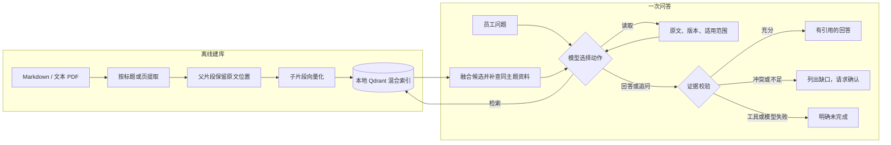

# 有证据的企业知识问答 Agent

> **题号 3 · 企业知识问答 Agent**｜让员工找到答案，也看得见答案从哪里来。

员工问“云端草稿能保留多久？”时，系统不会因为某份文档排在搜索结果第一位就回答“30 天”。它会继续读取另一份写着“15 天”的资料，列出两份原文和版本，并请用户确认适用制度。这是本项目的核心：**检索是找线索，读原文是取证，回答要过校验。**

本仓库是可运行的 CLI 项目，提供 DeepSeek 在线模型与离线 Mock 两条入口。所有制度、产品能力和案例均为**合成资料**，不代表真实小影科技的政策或产品承诺。

## 一眼看懂



| 能力 | 当前实现 |
|---|---|
| **模型动态决策** | LangGraph 的模型与工具节点循环；模型选择检索、读原文、补查或结束，工具调用上限默认 8 次。 |
| **混合检索** | 中文 dense 向量 `BAAI/bge-small-zh-v1.5` + jieba 分词的 `Qdrant/bm25`，按 RRF 融合；检索子片段，引用父片段。 |
| **冲突处理** | 扩展同主题及显式引用的文档；未给适用优先级时列双方证据并追问。 |
| **引用校验** | 引文须逐字来自本轮成功读取的片段；检查竞争资料、问题要点及“未规定”等资料缺口。失败不输出确定答案。 |
| **可审阅 Trace** | 记录动作、工具参数、返回摘要、后续动作和简要依据，不暴露模型内部思维。 |
| **故障边界** | 工具错误、调用超限、无效模型输出和接口故障返回明确状态；无效 JSON 最多尝试一次格式修复。 |

## 三个值得亲自看的例子

| 场景 | 观察结果 | 输入与真实模型记录 |
|---|---|---|
| **正常回答** | 自动字幕需要人工校对；答案带 K01 原文引用。 | [输入](examples/video_tool_kb/inputs/subtitle.json) · [Trace](examples/video_tool_kb/subtitle.json) |
| **资料冲突** | K13 写 30 天，K14 写 15 天；不擅自选新版本，要求确认适用制度。 | [输入](examples/video_tool_kb/inputs/retention_conflict.json) · [Trace](examples/video_tool_kb/retention_conflict.json) |
| **资料不足** | MP4 导出说明不能证明支持 4K HDR；请求补充资料。 | [输入](examples/video_tool_kb/inputs/four_k_unknown.json) · [Trace](examples/video_tool_kb/four_k_unknown.json) |

另外保存了[一次读取失败后补查的 Trace](examples/video_tool_kb/read_failure.json)和[两次无效 JSON 的失败记录](examples/video_tool_kb/subtitle_first_attempt.json)。这些在线记录来自较早版本；最新格式修复与问答相关性拦截已通过离线测试，**2026-11-03 DeepSeek 接口返回 HTTP 503，尚未完成新版本的在线重复成功率验证**。

## 快速跑起来

环境：Python 3.11+、PowerShell。首次安装：

```powershell
git clone https://github.com/Moming0215/enterprise-qa-agent.git
cd enterprise-qa-agent
python -m venv .venv
.\.venv\Scripts\python.exe -m pip install -e '.[test]'
if (-not (Test-Path .env)) { Copy-Item .env.example .env }
```

### 1. 建立短视频业务知识库索引

```powershell
.\.venv\Scripts\python.exe -m src.ingest_cli --source data/video_tool_kb/sources --index data/index/video_tool_kb
```

预期报告包含 `indexed_files: 44`、`failures: []`。首次向量化会下载模型；索引保存在本地 `data/index/`，不会进入 Git。

### 2. 不用 API，检查流程

```powershell
.\.venv\Scripts\python.exe -m src.cli --input examples/video_tool_kb/inputs/retention_conflict.json --mode mock --index-dir data/index/video_tool_kb --max-steps 30 --output examples/private/mock-conflict.json
.\.venv\Scripts\python.exe -m pytest -q
```

Mock 只证明工具链与边界规则，不能证明真实模型会怎样决策；扩大语料后它会机械读取较多候选，所以示例将工具上限设为 30。当前测试结果为 **50 passed**，见[实际输出](examples/video_tool_kb_v2/test-results.txt)。

### 3. 使用真实模型

在本机 `.env` 中填写 `DEEPSEEK_API_KEY`；默认接口与模型写在 [.env.example](.env.example)。不要提交 `.env`。运行：

```powershell
.\.venv\Scripts\python.exe -m src.cli --input examples/video_tool_kb/inputs/retention_conflict.json --mode online --index-dir data/index/video_tool_kb --output examples/private/online-conflict.json
```

CLI 在终端打印结果，同时保存 JSON。主要字段：`status`（`answered`、`needs_clarification`、`incomplete`）、`answer`、`citations`、`gaps`、`clarifying_question`、`error`、`trace`。`incomplete` 的退出码为 2。自定义问题参照[输入格式](examples/video_tool_kb/inputs/subtitle.json)，可加入 `history` 数组；CLI 参数见 `python -m src.cli --help`。

## 资料、效果与边界

[短视频工具模拟知识库](data/video_tool_kb/README.md)有 **44 份 Markdown、约 9,405 个汉字**，覆盖产品、授权、发布、客服、数据与安全流程；索引生成 104 个父片段和 104 个子片段。K13/K14 是故意保留的冲突资料。解析器也支持**可提取文字的 PDF**，有相应[测试](tests/test_hybrid_knowledge.py)。原始 JSON 小语料仍可通过 `--corpus` 使用，作为简化对照。

[70 条合成标注题](data/video_tool_kb/eval_all.json)包括 55 条有答案、15 条无答案、10 条跨文档和 3 条冲突题。[逐题检索结果](examples/video_tool_kb/retrieval_metrics_extended.json)显示 Raw Recall@3 为 **0.9515**、交付候选 Recall@3 为 **0.9636**、冲突双方召回 **3/3**；跨文档题仅 **6/10** 完整召回。无答案题有 14/15 仍返回相关候选，必须由回答阶段判断证据是否足够。这是同源合成集，**不能外推为真实企业准确率**。

复现检索评估：

```powershell
.\.venv\Scripts\python.exe -m src.evaluate_retrieval --dataset data/video_tool_kb/eval_all.json --index-dir data/index/video_tool_kb --output examples/private/retrieval-check.json
```

输出中的 `hybrid` 对应本知识库；`legacy` 使用另一套 JSON 小语料，不应直接比较。当前没有扫描 PDF OCR、DOCX/表格解析、文档权限控制、增量索引或通用语义蕴含证明；同主题冲突扩展依赖元数据。详见[评估记录](docs/03-evaluation.md)与[企业文档扩展设计](docs/06-enterprise-rag-extension.md)。

## 从哪里看代码

| 想了解 | 入口 |
|---|---|
| 题目需求、成功标准 | [docs/01-requirements.md](docs/01-requirements.md) |
| Agent 决策循环与 Trace | [src/agent.py](src/agent.py) |
| 文档摄取与混合检索 | [src/ingestion.py](src/ingestion.py) · [src/hybrid_knowledge.py](src/hybrid_knowledge.py) |
| 引用、冲突与输出校验 | [src/validation.py](src/validation.py) · [src/output_format.py](src/output_format.py) |
| 测试、评估与真实记录 | [tests/](tests/) · [docs/03-evaluation.md](docs/03-evaluation.md) · [examples/](examples/) |
| AI 辅助范围与个人贡献 | [docs/04-ai-usage.md](docs/04-ai-usage.md) |

项目使用 LangGraph 1.2.19 的 `StateGraph`、消息 reducer 和条件边承载工具循环；依赖版本见 [pyproject.toml](pyproject.toml) 与 [requirements.lock](requirements.lock)。设计借鉴 [LangChain ReAct 模板](https://github.com/langchain-ai/react-agent)的交互模式，以及 MIT 许可的 [agentic-rag-for-dummies](https://github.com/GiovanniPasq/agentic-rag-for-dummies) 的父子分块与混合检索思路；业务工具、引用校验和测试为本项目实现。
